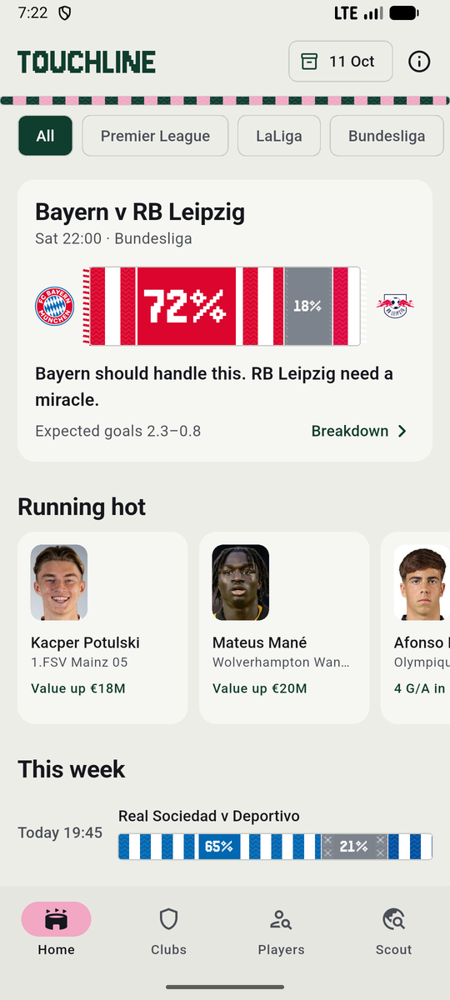
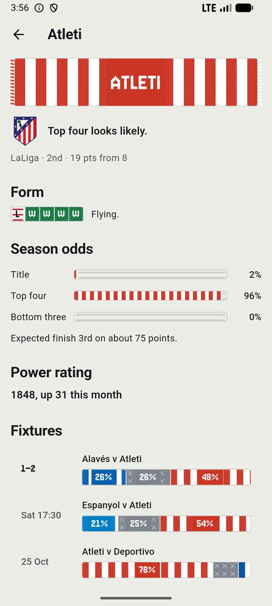
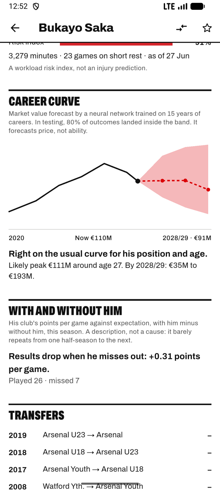
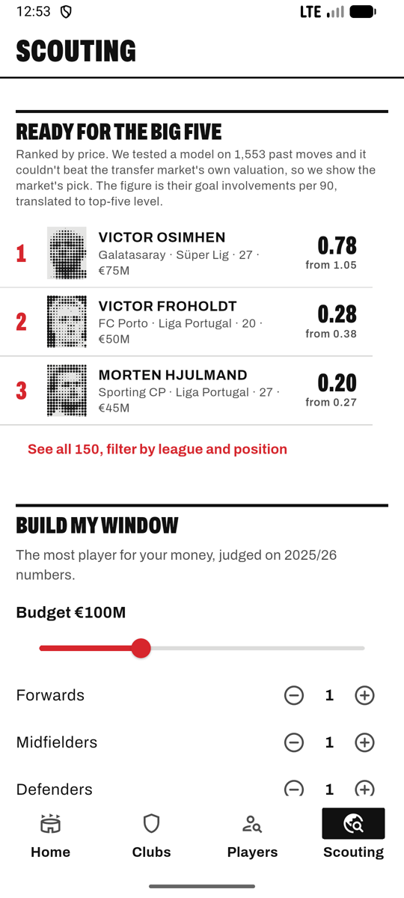
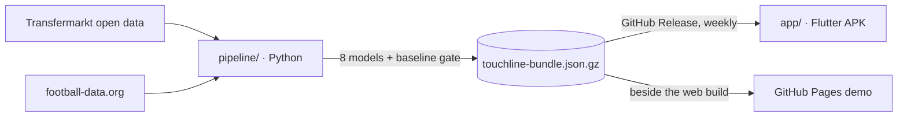

# Touchline

Football, read in seconds: match odds, fair values and form, from models tested on a season they never saw.

<p>
  
  
  
  
</p>

## What it does

- **Home**: the week's biggest match as a half-and-half scarf (each club's colours, width = win chance), plus who's running hot, clubs in form, power rankings, bargains and an overworked watch.
- **Clubs**: live tables for the top five leagues, plus title, top-four and bottom-three odds from 10,000 simulations.
- **Players**: 2,600+ players with search, filters, fair value against market price and the reasons behind it, a five-game forecast, a workload index and lookalikes.
- **Scout**: give it a budget and positions and it picks the best set of signings, solved exactly on the phone. Or start from a player and find a cheaper version.

## How it works



A weekly GitHub Action rebuilds the data, retrains and re-scores every model, and publishes one gzipped JSON file. If any model stops beating its simple baseline, nothing is published. The app ships with a copy of the data, works offline, and swaps in the newer file when it has signal.

## Results

Every number is measured on the **2025/26 season, held out from training** (time-based split).

| Model | What it predicts | Result | Simple baseline |
|---|---|---|---|
| Club Elo | Match winner | **68.9%** of decisive games | Always pick the home team: 59.0% |
| Elo-Poisson + Dixon–Coles | Win / draw / loss odds | RPS **0.203**, log-loss **0.996** | Base rates: RPS 0.229, log-loss 1.072 |
| LightGBM valuator (+ TreeSHAP) | Fair market value | Typical error **€4.7M**, median error **29%**, R² (log) **0.85** | Age × position × league median: €10.9M, 60% |
| GRU (deep learning) | Goal involvements, next 5 games | MAE **0.779**, Poisson deviance **1.165** | Poisson GLM: 0.795 / 1.196 · recent average: 0.828 / 1.421 |
| Monte Carlo season | Title / top 4 / bottom 3 | 10,000 simulations per league | — |
| Workload index + Isolation Forest | Load risk band | A risk index, not an injury prediction | — |
| k-NN on per-90 profiles | "Plays like X" | — | — |
| 0/1 integer programme | Best signings for a budget | Exact optimum (matches between Python and Dart) | Greedy value-per-euro |

The GRU's edge over a well-built Poisson GLM is small (about 3% on deviance). Sequence modelling helps a bit with football scoring, not a lot, and the README says so rather than leaning on a weak baseline. Details: [`pipeline/README.md`](pipeline/README.md).

## Run it

**Data pipeline**: see [`pipeline/README.md`](pipeline/README.md) (`python -m touchline.run`, about 3 minutes).

**App**
```bash
cd app
flutter run                    # emulator or device
flutter test                   # 72 tests, including the planner against the pipeline's optimal answers
flutter build apk --release --dart-define=BUNDLE_URL=https://github.com/<you>/<repo>/releases/download/data-latest/touchline-bundle.json.gz
```
Without `BUNDLE_URL` the APK runs on the data shipped inside it and never calls the network.

**Web demo**: push to GitHub, add the `FOOTBALL_API_KEY` secret, and set Settings → Pages → Source to **GitHub Actions**. The `pages` workflow builds the Flutter web app with the latest data beside it.

## Design

The visual idea is the terrace scarf. A fixture is a half-and-half matchday scarf whose seam sits at the win split, and a club's form is a short bar scarf: won solid, drew cross-stitched, lost as a dropped stitch, so colour is never the only signal. Lettering is Jersey, a typeface designed for charting knitting. See [`DESIGN.md`](DESIGN.md).

## Data, licences, limits

- Player and match history: [Transfermarkt open dataset](https://github.com/dcaribou/transfermarkt-datasets) (CC0). Live season: [football-data.org](https://www.football-data.org) (free tier, their terms).
- Market values are crowd estimates, not transfer fees. Player stats show the latest complete season in the open dataset, labelled in the app.
- There are no injury records, so workload is a risk index only.
- Club colours are hand-picked approximations of traditional colours, not official brand assets. Not affiliated with any club or league.
- Code: MIT. Jersey typeface: SIL Open Font License (`app/assets/fonts/OFL.txt`).
